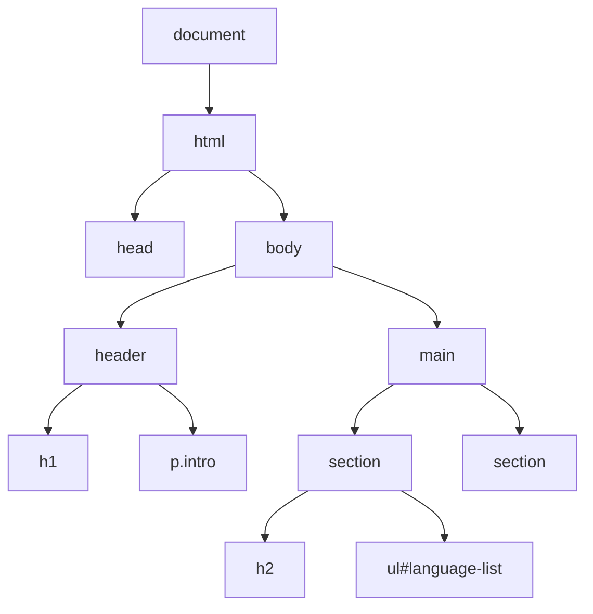

# Oppgave 4 - DOMen: finne, endre og lage elementer

## Mål med oppgave 4

Etter denne oppgaven skal du kunne:

- Forklare at DOMen er et tre av objekter som JavaScript kan lese og endre
- Finne elementer med `querySelector` og `querySelectorAll`
- Endre tekst, klasser, stil og attributter på elementer
- Forklare forskjellen på `textContent` og `innerHTML`, og hvorfor `innerHTML` kan være farlig
- Lage nye elementer fra data og legge dem inn på siden

## 4.0 - Oppsett

Fra nå av jobber vi med en ferdig side. I mappen `oppgave-4/start` ligger `index.html`, `style.css` og `script.js`.

:pencil2: Lag en ny mappe `oppgave-4` i mappen din fra oppgave 1 (for eksempel `js-workshop/oppgave-4`). Kopier `index.html`, `style.css` og `script.js` fra `oppgave-4/start` i dette repoet inn i den nye mappen. Har du ikke klonet repoet, kan du åpne filene på GitHub og kopiere innholdet.

:pencil2: Åpne `index.html` fra din egen mappe i nettleseren, og `script.js` i editoren. Det er her du skal skrive koden din.

:bulb: Jobb i din egen kopi, ikke i repoet. Da kan du hente oppdateringer i repoet uten konflikter, og startkoden og løsningsforslaget er alltid urørt, slik at du kan sammenligne med dem.

Siden har en tom liste, `<ul id="language-list">`. Ved slutten av oppgaven skal den fylles med språkene fra `languages`-listen i `script.js`.

## 4.1 - DOMen er et tre av objekter

:pencil2: Skriv dette i `Console`, én linje om gangen, og utforsk resultatet:

```js
document
document.body
document.body.children
console.dir(document.querySelector("h1"))
```

:bulb: `console.dir` viser elementet som et JavaScript-objekt i stedet for som HTML. Bla gjennom egenskapene. Du finner blant annet `textContent`, `className`, `parentElement` og `children`. Hvert element på siden er et objekt med hundrevis av egenskaper og metoder.

Slik ser treet ut for en del av siden:



## 4.2 - Finne elementer

`querySelector` tar en CSS-selektor og returnerer det **første** elementet som passer. `querySelectorAll` returnerer **alle** elementene som passer.

| Selektor | Finner |
|----------|--------|
| `"h1"` | Elementer av typen `<h1>` |
| `".fact"` | Elementer med `class="fact"` |
| `"#read-more"` | Elementet med `id="read-more"` |
| `"header p"` | `<p>`-elementer som ligger inne i en `<header>` |

:pencil2: Legg til følgende kode i `script.js`, og last siden på nytt:

```js
const heading = document.querySelector("h1");
heading.textContent = "My favourite programming languages";
```

:pencil2: Finn avsnittet med klassen `intro` og endre teksten til noe annet.

:pencil2: Bruk `querySelectorAll` til å finne alle avsnittene med klassen `fact`. Skriv ut hvor mange det er, og skriv ut teksten i hvert av dem med `forEach`:

```js
const facts = document.querySelectorAll(".fact");
console.log(facts.length);
facts.forEach((fact) => console.log(fact.textContent));
```

:bulb: `querySelector` returnerer `null` hvis ingenting passer, akkurat som vi så i oppgave 1. Får du `Cannot read properties of null`, er det nesten alltid fordi selektoren ikke traff noe.

## 4.3 - Endre klasser, stil og attributter

Den beste måten å endre utseendet til et element på er å legge til eller fjerne CSS-klasser. Da holder du stilen i CSS-filen og logikken i JavaScript.

:pencil2: Legg klassen `highlighted` på det første fakta-avsnittet. Klassen finnes allerede i `style.css`.

```js
facts[0].classList.add("highlighted");
```

:pencil2: Prøv også `classList.remove`, `classList.toggle` og `classList.contains` i konsollen på et av DOM-elementene. Hva gjør de?

:pencil2: Skjul det siste fakta-avsnittet ved å legge på klassen `hidden`.

Du kan også endre stil direkte med `style`. Legg merke til at CSS-egenskaper med bindestrek skrives i camelCase:

```js
heading.style.color = "rebeccapurple";
heading.style.fontStyle = "italic"; // font-style in CSS
```

:pencil2: Finn lenken med id `read-more`. Endre teksten, og få den til å åpne i en ny fane ved å sette attributtet `target` til `"_blank"`:

```js
const link = document.querySelector("#read-more");
link.setAttribute("target", "_blank");
console.log(link.href);
```

## 4.4 - `textContent` eller `innerHTML`?

:pencil2: 🤔 Hva er forskjellen? Prøv begge i konsollen.

```js
const intro = document.querySelector(".intro");
intro.textContent = "This is <strong>important</strong>";
intro.innerHTML = "This is <strong>important</strong>";
```

`textContent` setter inn ren tekst. `innerHTML` tolker teksten som HTML og lager nye elementer.

:pencil2: Tenk deg at teksten kommer fra noe en bruker har skrevet inn. Prøv dette i konsollen:

```js
const userInput = ``;
intro.innerHTML = userInput;
```

:exclamation: Dette kalles **XSS** (cross-site scripting). Hvis du setter inn tekst fra brukere eller fra et API med `innerHTML`, kan noen kjøre sin egen JavaScript på siden din. Bruk `textContent` når du skal vise tekst, og lag elementer med `createElement` (neste del) når du trenger HTML-struktur.

## 4.5 - Lage nye elementer

Med `document.createElement` lager du et nytt element. Det finnes bare i minnet til du legger det inn i DOMen, for eksempel med `append`.

:pencil2: Legg til ett språk i listen:

```js
const list = document.querySelector("#language-list");

const item = document.createElement("li");
item.textContent = "Elm (2012)";
list.append(item);
```

:pencil2: Fjern koden over igjen, og lag i stedet et `<li>`-element for **hvert** språk i `languages`. Hvert element skal vise navn og år, for eksempel `Python (1991)`.

:bulb: Bruk `forEach` fra oppgave 3, eller en `for...of`-løkke.

## 4.6 - Fra data til DOM med en funksjon

I neste oppgave skal listen oppdateres når brukeren søker eller legger til nye språk. Da er det lurt å samle koden som tegner listen i én funksjon.

:pencil2: Skriv en funksjon `renderLanguages(languagesToShow)` som:

1. Tømmer listen med `list.replaceChildren()`
2. Lager et `<li>` for hvert språk i `languagesToShow` og legger det inn i listen

```js
function renderLanguages(languagesToShow) {
  list.replaceChildren();
  // ...
}

renderLanguages(languages);
```

:pencil2: Test funksjonen ved å kalle den med en filtrert liste, for eksempel bare språkene fra 2010 og senere. Bruk `filter` fra oppgave 3.

:bulb: Legg merke til mønsteret: *dataene* (`languages`) er kilden til sannheten, og `renderLanguages` gjør dataene om til DOM-elementer. Når dataene endres, kaller vi bare funksjonen på nytt. Det er nøyaktig denne ideen rammeverk som React er bygget på.

## 🌶️ Ekstra

- Legg klassen `new` på `<li>`-elementer for språk fra 2010 og senere. Klassen finnes allerede i `style.css`.
- Lag mer struktur i hvert listeelement: navnet i et `<strong>`-element og året i et eget `<span>`. Bruk `createElement` og `append`, ikke `innerHTML`.
- Legg til et avsnitt under listen som viser `Showing 8 languages`, og oppdater teksten i `renderLanguages`.
- Marker et element i `Elements`, og bruk `$0.parentElement`, `$0.children`, `$0.nextElementSibling` og `$0.closest("section")` i konsollen for å navigere rundt i treet.
- Se på elementet `<template>` i HTML. Lag en mal for et listeelement i `index.html`, og bruk `template.content.cloneNode(true)` til å lage elementene.

---

[:arrow_right: Gå til neste oppgave](../oppgave-5/README.md)
