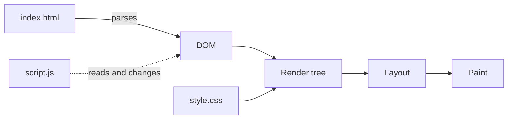
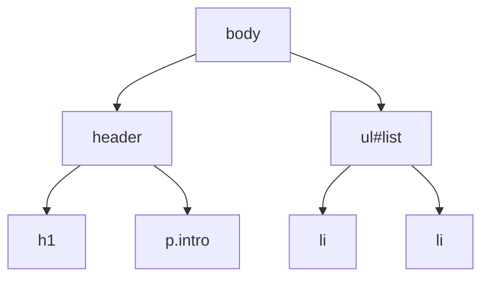
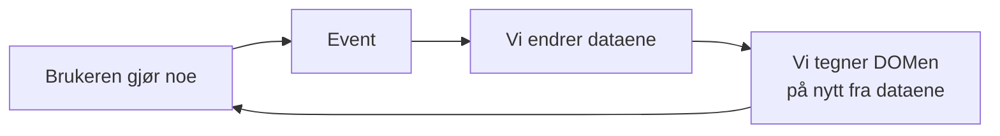

<!-- TODO: legg inn dato for workshopen i undertittelen -->
<div class="terminal">
  <div class="terminal-bar">
    <span class="dot red"></span><span class="dot yellow"></span><span class="dot green"></span>
    <span class="terminal-title">DevTools — Console</span>
  </div>
  <div class="terminal-body">
    <div class="cmd"><span class="prompt">&gt;</span> document.title = "Introduksjon til JavaScript"</div>
    <h1>Introduksjon til JavaScript</h1>
    <p class="subtitle">// HTML, DOM og nettleseren · Ålesund Techschool</p>
  </div>
</div>

---

# Ålesund Techschool

- Forskjellige fagfolk fra IT-bransjen i Ålesund som ønsker å dele
- Knytte bro mellom de som skal inn i IT-bransjen og de som jobber der. Bli kjent med fremtidens kollegaer, bli kjent med arbeidsmetodikk ++
- Arena for nettverk og læring
- Representert p.t:
  - NTNU
  - Boitano
  - Reknes
  - Solwr
  - Twoday
  - Kystverket

**Discord**

---

# Hvem er vi

<!-- TODO: legg til medforelesere -->
- Marius Kalvø (Kystverket)
- Magnus Grande (NTNU)

---

# Agenda

- HTML, CSS og JavaScript
- DOMen
- Events og callbacks
- DevTools
- Oppgaver: JS og DOM
- Oppgaver: Enkel applikasjon med API

---

# HTML, CSS og JavaScript

- **HTML** beskriver innholdet og strukturen
- **CSS** bestemmer utseendet
- **JavaScript** står for oppførselen

```html
<h1 class="title">Hello!</h1>


<style> 
  .title { color: red; } 
</style> 

<script>
  document.querySelector(".title").textContent = "Hello from JS!";
</script>
```

---

# JavaScript

- Laget på rundt ti dager i 1995 for nettleseren Netscape
- Har ingenting med Java å gjøre, bortsett fra navnet
- Språk som kjører direkte i alle nettlesere
- Kjører i dag også på servere (Node.js), i apper og i verktøy
- Dynamisk typet: variabler har ingen fast type
- Standardiseres som ECMAScript, med en ny versjon hvert år
- TypeScript = JavaScript med typer, som kompileres til JavaScript

---
layout: two-cols-header
---

# JavaScript - Cheatsheet

::left::

```js
const name = "Ada";
let count = 0;
count = count + 1;

if (count === 1) {
  console.log(`Hello, ${name}!`);
}

function add(a, b) {
  return a + b;
}

const square = (x) => x * x;
```

::right::

```js
const languages = [
  { name: "C", year: 1972 },
  { name: "Rust", year: 2015 },
];

languages[0].name; // "C"


const names = languages.map((l) => l.name);
const modern = languages.filter(
  (l) => l.year > 2000,
);
```

---

# Wat

Fra foredraget «Wat» av Gary Bernhardt (Destroy All Software, 2012)

<!-- Each example takes two clicks: first the expression, then the answer -->
<div class="wat">
  <code v-click>[] + []</code>
  <code v-click>""</code>
  <code v-click>[] + {}</code>
  <code v-click>"[object Object]"</code>
  <code v-click>Array(16).join("wat" - 1) + " Batman!"</code>
  <code v-click>"NaNNaNNaN...NaN Batman!"</code>
  <code v-click>"b" + "a" + +"a" + "a"</code>
  <code v-click>"baNaNa"</code>
  <code v-click>[10, 1, 3].sort()</code>
  <code v-click>[1, 10, 3]</code>
  <code v-click>[] == ![]</code>
  <code v-click>true</code>
</div>

<v-click>

Nesten alt skyldes automatisk typekonvertering. Bruk `===`, og ikke bland typer.

</v-click>

<style>
.wat {
  display: grid;
  grid-template-columns: auto 1fr;
  gap: 0.6rem 3rem;
  margin: 1.5rem 0;
  font-size: 1.1em;
}
</style>

---

# Document Object Model (DOM)



- Nettleseren leser HTML ovenfra og ned og bygger DOMen
- JavaScript endrer DOMen, og nettleseren tegner siden på nytt

---
layout: two-cols-header
---

# Document Object Model (DOM)

HTML er tekst. DOMen er et levende tre av objekter som nettleseren bygger fra teksten.

::left::

```html
<body>
  <header>
    <h1>Languages</h1>
    <p class="intro">...</p>
  </header>
  <ul id="list">
    <li>C</li>
    <li>Rust</li>
  </ul>
</body>
```

::right::



---

# Document Object Model (DOM)

- DOMen bygges fra HTML-filen når siden lastes
- JavaScript endrer DOMen, aldri filen
- Last siden på nytt, og alle endringene er borte
- `View source` viser filen. `Elements` i DevTools viser DOMen
- Hvert element er et objekt med egenskaper og metoder

```js
const heading = document.querySelector("h1");
heading.textContent = "New heading";
heading.classList.add("highlighted");

const item = document.createElement("li");
item.textContent = "Kotlin";
document.querySelector("#list").append(item);
```

---

# XSS: cross-site scripting

- `innerHTML` tolker teksten som HTML og lager nye elementer
- Kommer teksten fra en bruker eller et API, kan noen få sin egen JavaScript til å kjøre på siden din
- Den koden har tilgang til alt siden har: DOMen, dataene og innloggingen til brukeren

```js
const comment = ``;

element.innerHTML = comment;   // ❌ creates an , and onerror runs the code
element.textContent = comment; // ✅ shown as plain text
```

- Bruk `textContent` for tekst, og `createElement` når du trenger HTML-struktur
- Rammeverk som React gjør dette for deg, men har egne nødutganger, som `dangerouslySetInnerHTML`

---

# Events og callbacks

- Nettleseren sender ut **events** når noe skjer: klikk, tastetrykk, skjema, scrolling ...
- Vi gir nettleseren en **callback** som skal kalles når eventen skjer
- Vi kaller aldri funksjonen selv

```js
const button = document.querySelector("#save");

button.addEventListener("click", (event) => {
  console.log("Clicked!", event.target);
});
```

- Dette mønsteret går igjen overalt: klikk, timere, henting av data fra nettet

---

# Data → DOM



- Dataene er kilden til sannheten, ikke DOMen
- Dette er ideen bak rammeverk som React, Vue og Angular
- I dag gjør vi det for hånd, slik at du forstår hva rammeverkene gjør for deg

---

# DevTools

- Åpne med `F12` eller `Cmd+Option+I`
- **Console**: kjør JavaScript og se feilmeldinger
- **Elements**: se og endre DOMen
- **Sources**: se koden og sett breakpoints
- **Network**: se alt nettleseren henter

**Når noe ikke fungerer: åpne Console og se etter rødt.**

---
layout: center
---

# Demo

---

# Oppgaver

| | Tema | Nivå |
|---|---|---|
| 1 | Oppsett, HTML og DevTools | ●○○ |
| 2 | Grunnleggende JavaScript | ●○○ |
| 3 | Objekter, arrays og funksjoner som verdier | ●●○ |
| 4 | DOMen: Finne, endre og lage elementer | ●●○ |
| 5 | Events: Reagere på brukeren | ●●○ |
| 6 | Hente data fra et API: Værstasjoner | ●●● |
| 7 - 8 | App, continued.. | ●●● |

---

# Oppgaver 

- Hver oppgave bygger på den forrige. Fra oppgave 4 finnes en `start`-mappe, så du kan hoppe rett inn. Kopier med deg filer.
- Kan du det fra før? Hopp over, og prøv 🌶️-oppgavene.
- Ser du at alt er kjent materie? 
  - Gå off-road: bygg noe eget med API-et (og evt andre API), grav deg ned i detaljer. Sett av tid til å lære deg noe nytt.

---

# Oppgaver

- <https://github.com/Aalesund-Techschool/js-intro>
- https://discord.gg/wJjYFACUbQ
- Skriv koden selv i stedet for å kopiere
- Står ikke svaret i oppgaveteksten? Søk på nettet. **MDN** (<https://developer.mozilla.org>) er et flott oppslagsverk for JavaScript
- Spør om du sitter fast, eller vil diskutere
- Har du noe relevant du vil dele?
  Legg inn en melding i **#workshops** på **Discord**
